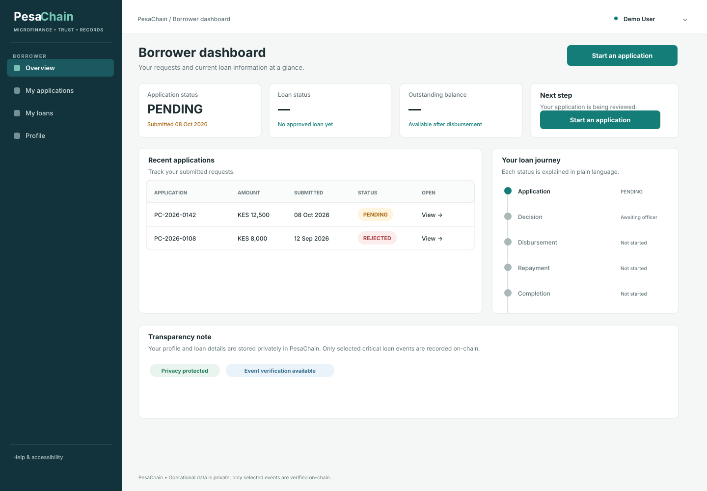
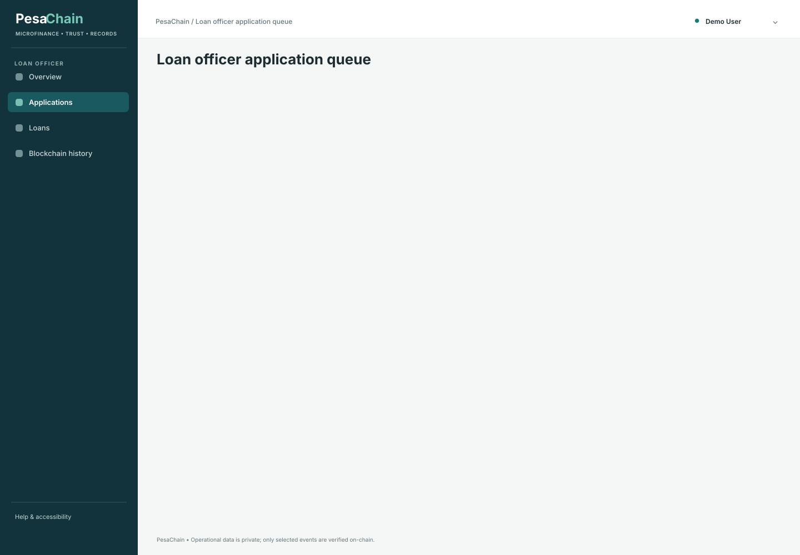
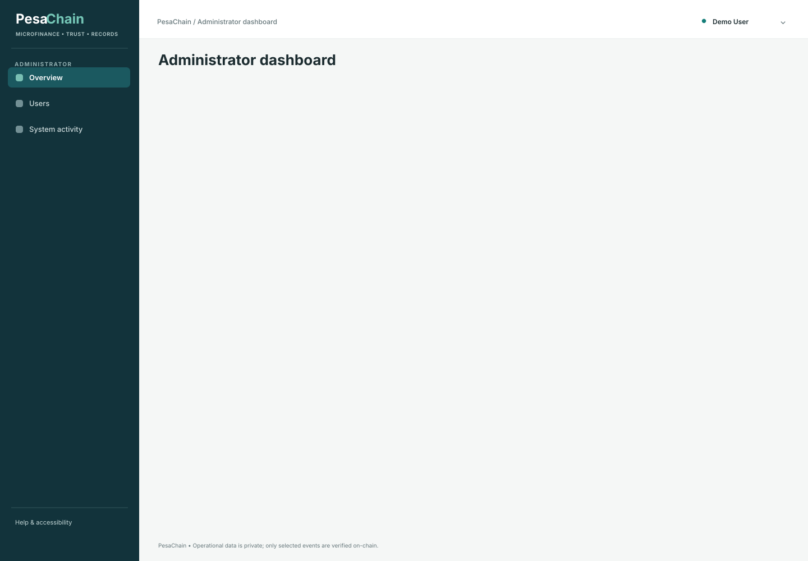
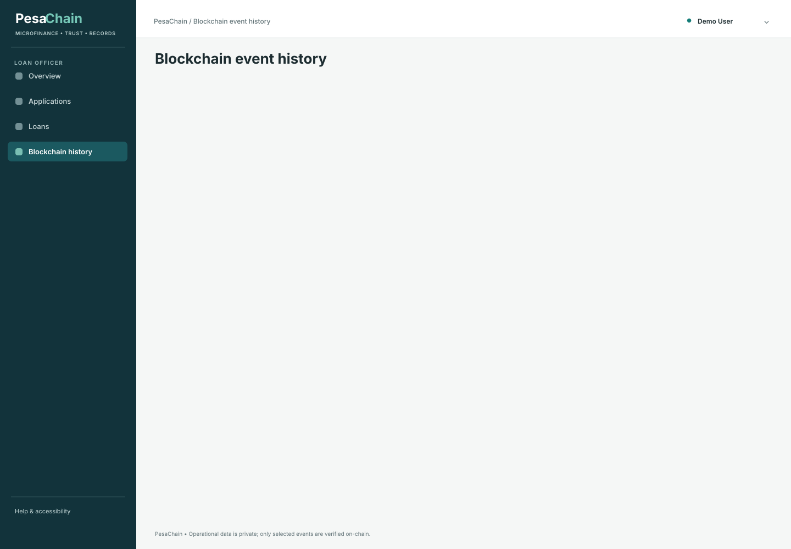
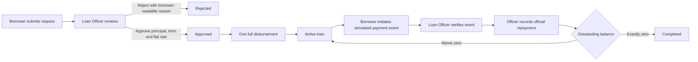
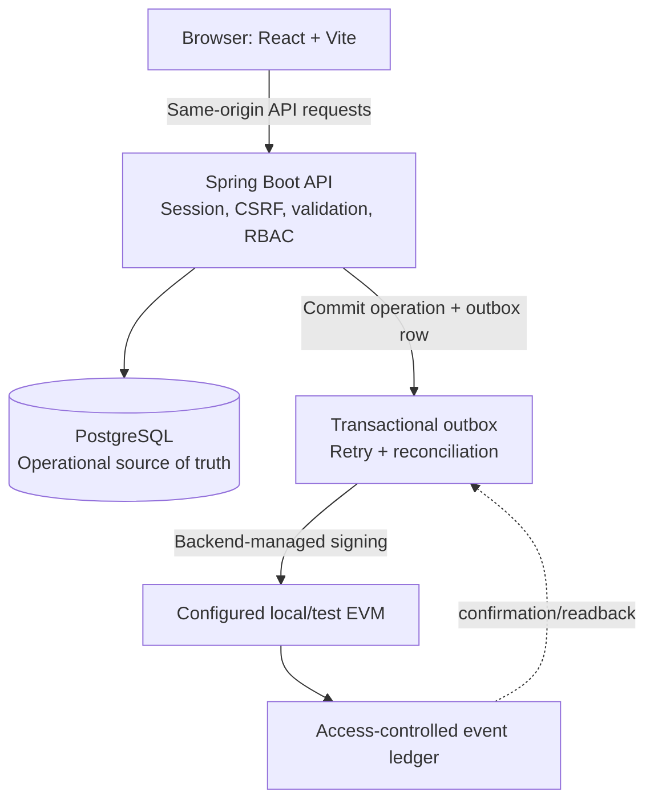

<div align="center">
  
  <h1>PesaChain</h1>
  <p><strong>A clearer loan journey. Selected events, independently verifiable.</strong></p>
  <p>
    Loan application, human review, full disbursement, and simulated repayment workflows
    with operational records in PostgreSQL and separate blockchain evidence for selected events.
  </p>
</div>

<div align="center">
  
  
  
  
  
  
</div>

<br />

> **The core idea:** make the loan process easier to follow without pretending that a blockchain moves money or replaces a human lending decision.

## Contents

- [Why PesaChain](#why-pesachain)
- [A visual tour](#a-visual-tour)
- [How a loan moves through the system](#how-a-loan-moves-through-the-system)
- [Product capabilities](#product-capabilities)
- [Roles and access boundaries](#roles-and-access-boundaries)
- [Architecture and trust boundaries](#architecture-and-trust-boundaries)
- [Brand and interface](#brand-and-interface)
- [Technology](#technology)
- [Run it locally](#run-it-locally)
- [Verify the project](#verify-the-project)
- [Configuration and safety](#configuration-and-safety)
- [Known boundaries](#known-boundaries)
- [Project documentation](#project-documentation)

## Why PesaChain

Loan work involves more than recording an amount. Borrowers need to understand what they requested, what was decided, whether a loan has been disbursed, and which repayments have officially changed the balance. Staff need a traceable review process. Administrators need operational oversight without receiving lending authority by default.

PesaChain brings those steps into one role-aware application. PostgreSQL holds the working loan records. A backend-managed blockchain integration records selected financial events separately, so an operator can inspect delivery and confirmation without confusing it with the loan's operational status.

This is a local-first academic system and demonstrator. It is not a bank, a payment rail, or a production lending service.

## A visual tour

The repository includes supplied interface wireframes and system diagrams. The images below are **design wireframes**, not claims of captured production screens or persisted user data.

<table>
  <tr>
    <td width="50%"><br /><sub>Borrower workspace concept</sub></td>
    <td width="50%"><br /><sub>Loan Officer queue concept</sub></td>
  </tr>
  <tr>
    <td width="50%"><br /><sub>Administrator oversight concept</sub></td>
    <td width="50%"><br /><sub>Selected event evidence concept</sub></td>
  </tr>
</table>

> The live interface uses the same product roles and brand direction. Browser screenshots and viewport-by-viewport acceptance evidence have not been saved in this repository; see [implementation status](docs/IMPLEMENTATION_STATUS.md) for the latest verification record.

### System at a glance


## How a loan moves through the system



Application and loan lifecycle status are operational records. Blockchain delivery status is tracked separately (`PENDING`, `PROCESSING`, `SUBMITTED`, `RECORDED`, or `FAILED`). `RECORDED` means the configured confirmation condition was met; it does not mean that money moved.

## Product capabilities

### Borrower workspace

- Register and sign in using a server-side session.
- Submit an application with a requested KES principal and term.
- See application decisions, approved terms, loan lifecycle, balance, and recorded repayment history for their own records.
- Initiate a **simulated** repayment event for an eligible active loan.
- View the delivery status of relevant selected event evidence.
- Download an available repayment receipt after an official repayment is recorded.

### Loan Officer workspace

- Review and search the pending application queue.
- Approve or reject applications with a decision rationale; rejection includes a borrower-readable reason.
- Set approved principal, term, and flat rate while preserving the original request.
- Disburse the approved principal once, in full.
- Review simulated repayment events, verify them, then record the official repayment.
- Inspect permitted borrower history and loan servicing information to support a human decision.

### Administrator workspace

- Provision and manage staff accounts and access status.
- Review permitted, paginated audit activity.
- View aggregate system reports and blockchain delivery/reconciliation monitoring.
- Download an aggregate report where the feature is available.

Administrator permissions do not automatically include Loan Officer lending actions. Backend authorization is the security boundary; hiding a button is not authorization.

### Reports, search, and receipts

- Role-scoped search is used where it supports a real workflow; server-side results are bounded and paginated.
- Administrator reports use aggregate data and avoid exposing borrower identity in the report response.
- PDF receipts and reports are branded, structured documents derived from persisted API data. They are **not digitally signed or tamper-proof certificates**.

## Roles and access boundaries

| Role | Intended access |
| --- | --- |
| Borrower | Own profile, applications, loans, repayment events, official repayments, and related evidence. |
| Loan Officer | Application review and decisions, full disbursement, repayment verification/recording, and permitted borrower/loan history. |
| Administrator | Staff-account management, permitted audit activity, aggregate reporting, and system/blockchain monitoring. No automatic lending authority. |

State-changing requests use session authentication and CSRF protection. Public registration cannot assign privileged roles. Staff provisioning is administrator-managed and newly provisioned staff must complete the required password-change flow.

## Architecture and trust boundaries



**Operational data stays in PostgreSQL:** borrower identity, applications, decision notes, loan terms and balances, repayment details, and lifecycle history. The contract receives only the selected, minimal event information defined by the implementation. Borrower personal information and free-text notes are not published on-chain.

Blockchain submission is asynchronous. An RPC outage can leave an operationally committed event pending or failed while the loan or repayment operation remains committed in PostgreSQL. Retries and reconciliation track evidence delivery; they do not rewrite the operational loan record.

## Brand and interface

### PesaChain identity

<div align="center">
  
</div>

| Brand token | Hex | Use |
| --- | --- | --- |
| **Emerald Ink** |  | `#064E3B` · Primary actions, brand emphasis, navigation, and important states. |
| **Champagne** |  | `#F8E7C9` · Warm highlights, supporting actions, and selected accents. |
| Warm off-white | — | Main light surfaces and page backgrounds. |

The authenticated workspace also supports a persisted dark theme. Public landing and authentication pages retain the light brand treatment. The interface includes responsive layouts, visible focus styling, reduced-motion handling, status distinctions, empty/loading/error states, and restrained motion where implemented. Rendered accessibility and viewport coverage should be read from the current [implementation status](docs/IMPLEMENTATION_STATUS.md), not inferred from source alone.

## Technology

| Layer | Implementation |
| --- | --- |
| Frontend | React 19, TypeScript, Vite 8, Tailwind CSS 4 |
| Backend | Java / Spring Boot 3.5, Spring Security, session cookies, CSRF |
| Database | PostgreSQL 17 with additive Flyway migrations (V1–V10 in this checkout) |
| Blockchain | Solidity event ledger, Hardhat 3 local chain, backend-managed Web3j signing |
| Reliability | Transactional outbox, controlled retries, confirmation tracking, reconciliation |
| Tests | Maven/Spring integration tests with PostgreSQL Testcontainers; Hardhat contract tests |

## Run it locally

### Prerequisites

- Windows PowerShell (commands below), or adapt them for your shell.
- Node.js 22, Corepack, and pnpm 10.34.3.
- Java 21 or newer and the checked-in Maven wrapper.
- Docker Desktop for the local PostgreSQL service.
- Optional: a local Hardhat node for blockchain event delivery.

### 1. Install frontend and contract dependencies

From the repository root:

```powershell
corepack pnpm@10.34.3 install --frozen-lockfile
```

Install the blockchain workspace separately when you intend to run its contract tools:

```powershell
Set-Location blockchain
corepack pnpm@10.34.3 install --frozen-lockfile
Set-Location ..
```

### 2. Configure local environment

Copy the example file and fill it locally; do not commit `.env`:

```powershell
Copy-Item .env.example .env
```

Set the local PostgreSQL database, username, and password values in `.env` for Docker Compose. Set backend variables in the environment of the backend process (for example, the IDE run configuration). **Spring Boot does not automatically load a root `.env` file.** Important backend properties include:

```text
PESACHAIN_DB_URL
PESACHAIN_DB_USERNAME
PESACHAIN_DB_PASSWORD
PESACHAIN_COOKIE_SECURE=false       # local HTTP only
PESACHAIN_SIMULATION_HMAC_SECRET   # at least 32 UTF-8 bytes; keep stable
PESACHAIN_BOOTSTRAP_ADMIN_EMAIL
PESACHAIN_BOOTSTRAP_ADMIN_PASSWORD
```

Keep all credentials, HMAC keys, and signer keys out of source control and frontend variables. Do not use example or local Hardhat credentials on any live network. Do not publish real borrower data in a demonstration.

### 3. Start PostgreSQL

From the repository root:

```powershell
docker compose up -d postgres
docker compose ps
```

The Compose service uses the named `pesachain-postgres-data` volume. Flyway applies pending migrations when the backend starts. Do not remove the volume or reset migrations to troubleshoot routine setup problems.

### 4. (Optional) Start a local blockchain

In a separate terminal:

```powershell
Set-Location blockchain
corepack pnpm@10.34.3 run node
```

In another blockchain terminal, compile/test and deploy to the local chain:

```powershell
Set-Location blockchain
corepack pnpm@10.34.3 run compile
corepack pnpm@10.34.3 test
corepack pnpm@10.34.3 run deploy:local
```

The Hardhat node is ephemeral. Its chain is reset when the node stops, so redeploy and configure the backend with the **address printed for that current node**. Configure the backend with the local RPC URL, chain ID `31337`, deployed contract address, and a local test signer key through its process environment. The frontend never connects directly to the RPC endpoint.

For loan/application development without blockchain delivery, configure the documented backend worker setting to remain disabled; selected events will not be confirmed on-chain in that mode.

### 5. Start the backend

Open a new PowerShell terminal where the backend environment variables are configured:

```powershell
Set-Location backend
./mvnw.cmd spring-boot:run
```

The API listens on port `8080` by default. Flyway migrates the configured PostgreSQL database at startup. Use a unique local bootstrap administrator credential; there is no safe public default credential to publish in this README.

### 6. Start the frontend

From the repository root, in another terminal:

```powershell
corepack pnpm@10.34.3 run dev -- --host 127.0.0.1 --port 8443
```

Open [http://localhost:8443](http://localhost:8443). The Vite development server proxies API requests to the backend; the application uses same-origin session and CSRF behavior. Review `vite.config.ts` if your local backend port differs.

## Verify the project

From the repository root:

```powershell
corepack pnpm@10.34.3 exec tsc --noEmit
corepack pnpm@10.34.3 run build
```

For backend verification:

```powershell
Set-Location backend
./mvnw.cmd verify -q
Set-Location ..
```

For the Hardhat contract suite:

```powershell
Set-Location blockchain
corepack pnpm@10.34.3 run compile
corepack pnpm@10.34.3 test
corepack pnpm@10.34.3 run typecheck
Set-Location ..
```

Backend integration tests use disposable PostgreSQL Testcontainers databases where Docker is available. An opt-in test exercises the backend against a deployed local Hardhat node; see `docs/claude/02-BLOCKCHAIN.md` for its environment gate and exact procedure. Check test output and `docs/IMPLEMENTATION_STATUS.md` for actual, current results—commands in this README are instructions, not a claim that they have just passed in your environment.

## Configuration and safety

- **Loan terms:** Kenyan shillings (KES); flat interest is calculated on the original approved principal for the full approved term, rounded to two decimals using half-up rounding. Zero-percent interest is valid. There are no configured invented caps, fees, or penalties.
- **Disbursement:** one full disbursement equal to the approved principal; partial/tranche disbursement is not supported.
- **Repayment:** borrower-initiated simulation, backend signing/verification, Loan Officer verification and official recording. Simulation is not a money transfer. Only an official recorded repayment changes the operational balance.
- **Authorization:** server-side roles and borrower ownership checks apply. Administrators do not inherit lending actions.
- **Blockchain:** use only an isolated local/test chain for this academic implementation. Confirm RPC, chain ID, deployed address, signer permission, and required confirmations before expecting `RECORDED` status.
- **Data:** avoid real personal or financial data in a public demo. Do not expose secrets in `.env.example`, screenshots, logs, issue reports, frontend source, or this README.

## Known boundaries

- Simulated repayments do not initiate or prove real-world payment.
- Blockchain event delivery is separate from the PostgreSQL loan lifecycle and may be pending or failed while an operational transaction remains committed.
- A Hardhat localhost address is temporary and not a public deployment.
- Receipt/report PDFs are visual application records, not digitally signed or cryptographic proofs.
- This repository is not evidence of production uptime, regulatory approval, lending suitability, or security certification.
- A free-tier deployment plan is documented in [`docs/FREE_DEPLOYMENT_GUIDE.md`](docs/FREE_DEPLOYMENT_GUIDE.md), including its host and same-origin proxy prerequisites.

## Project documentation

- [Implementation status and verification record](docs/IMPLEMENTATION_STATUS.md)
- [Architecture decisions](docs/DECISIONS.md)
- [Frontend/API integration map](docs/FRONTEND_INTEGRATION_MAP.md)
- [Loan decisions and disbursement](docs/LOAN_DECISIONS_AND_DISBURSEMENT.md)
- [Free-tier deployment guide](docs/FREE_DEPLOYMENT_GUIDE.md)
- [Backend domain guide](docs/claude/01-BACKEND-DOMAIN.md)
- [Blockchain and outbox guide](docs/claude/02-BLOCKCHAIN.md)
- [UI/UX guide](docs/claude/03-UI-UX.md)
- [Testing and security guide](docs/claude/04-TESTING-SECURITY.md)
- [Hardhat workspace guide](blockchain/README.md)

---

<div align="center">
  <sub>Built around clear responsibilities, persistent records, and careful claims about what the evidence proves.</sub>
</div>
